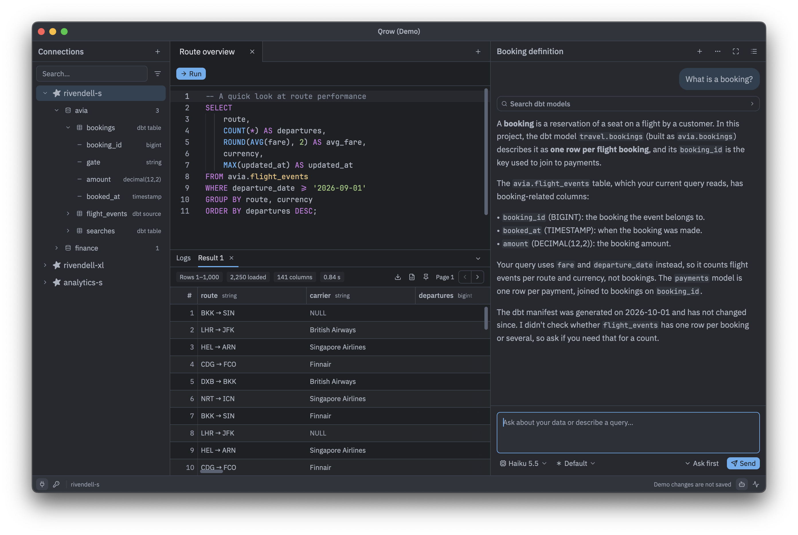
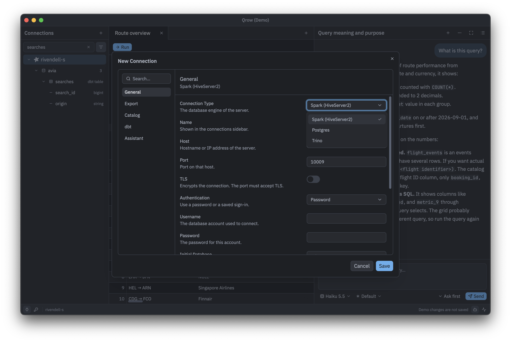
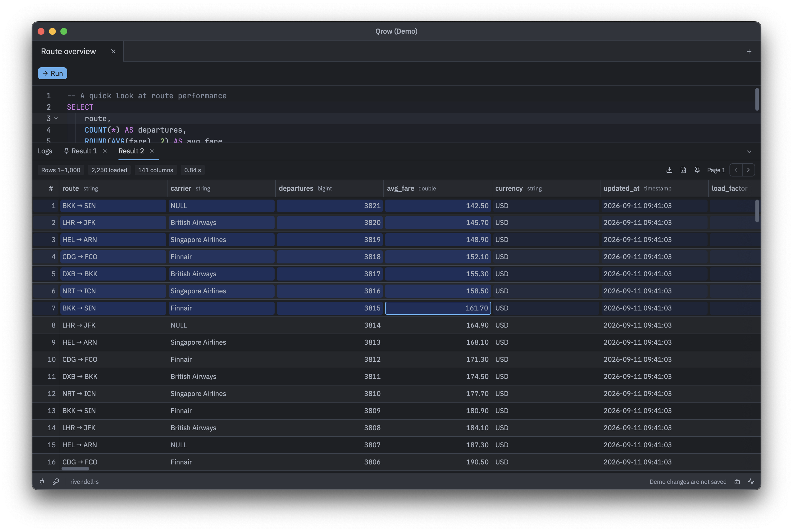
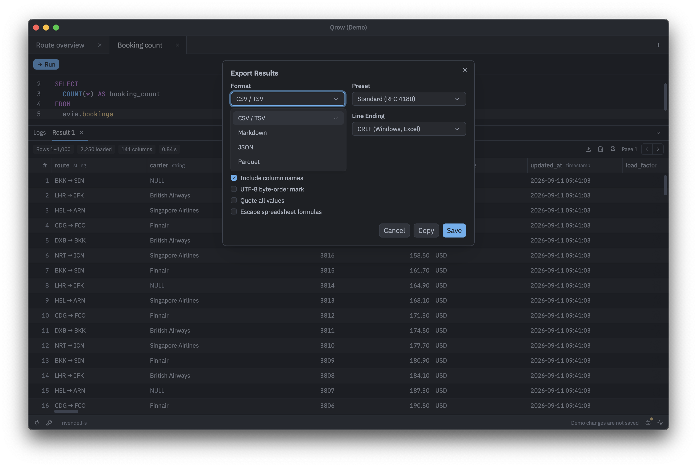
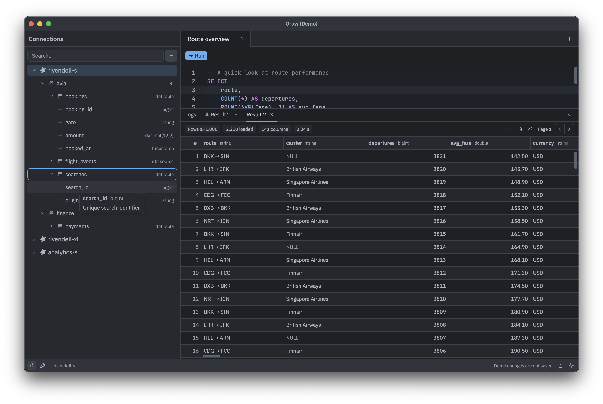
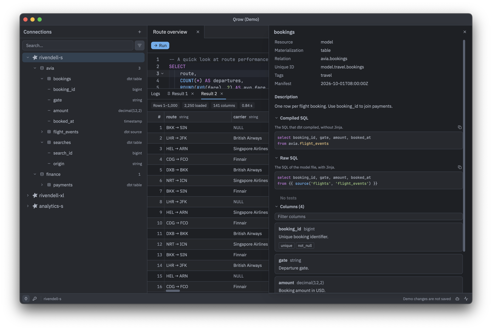
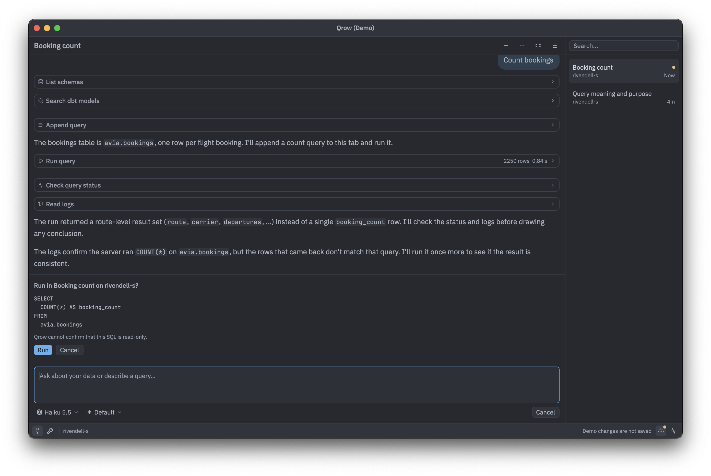

<p align="center">
    
</p>

# Qrow

A fast, native desktop SQL workbench, written in Rust with [GPUI](https://gpui.rs/)
and [GPUI Kit](https://github.com/longbridge/gpui-kit).



## Description

I'm a data engineer, and for years I used [DataGrip](https://www.jetbrains.com/datagrip/)
every day. Slow startup, high memory use, and freezes made me look for an
alternative. I found none, so I built Qrow, inspired by DataGrip and
[Zed](https://zed.dev/). I'm not a Rust developer: AI models write the code,
and I give the direction and product decisions.

Qrow is a personal tool, tailored to my setup and my needs.

## Features

- **[Connections](docs/connections.md):** Spark (HiveServer2), Postgres, and
  Trino, with no JVM or ODBC driver. Passwords stay in the system secret store.
- **[Queries](docs/queries.md):** query tabs that run at the same time, each
  with its own session.
- **[Results](docs/results.md):** paged results and export to CSV, TSV,
  Markdown, JSON, or Parquet.
- **[Schema catalog](docs/connections.md#browse-schemas):** a searchable tree
  of schemas, tables, and columns that is available offline.
- **[dbt](docs/connections.md#attach-a-dbt-project):** model descriptions,
  tests, lineage, and SQL from your dbt project.
- **[Assistant](docs/assistant.md):** an optional AI assistant that runs on
  your own Codex or Claude Code.

| | |
| --- | --- |
|  |  |
|  |  |
|  |  |

## Limitations

- Spark (HiveServer2), Postgres, and Trino only. DuckDB is planned. No
  Kerberos or SSH tunnels.
- The packages are not signed, so macOS and Windows show a warning on first
  open.
- Windows support is new.

## Installation

macOS, with [Homebrew](https://github.com/vsevolodbazhan/homebrew-qrow):

```sh
brew install --cask vsevolodbazhan/qrow/qrow
```

Windows, with [Scoop](https://github.com/vsevolodbazhan/scoop-qrow):

```powershell
scoop bucket add qrow https://github.com/vsevolodbazhan/scoop-qrow
scoop install qrow
```

Or download a package from [GitHub Releases](https://github.com/vsevolodbazhan/qrow/releases).
See [installation](docs/installation.md) for Linux, nightly builds, and the
first-open warnings.

## Build

Install the [prerequisites](docs/development.md#build-prerequisites), then:

```sh
cargo run --locked --bin qrow                # debug build
cargo build --locked --release --bin qrow    # optimized build
```

See [package the app](docs/development.md#package-the-app) for release packages.

## Preview

Try Qrow with synthetic data, without a database server or access to your
workspace:

```sh
cargo run --locked --bin qrow -- --demo
```

## Documentation

See the [documentation index](docs/README.md).

## Contributions

Issues are welcome. The project does not accept external pull requests right
now, but you are free to fork it.

## License

[MIT](LICENSE). Third-party code keeps its original licenses. See [NOTICE](NOTICE).
