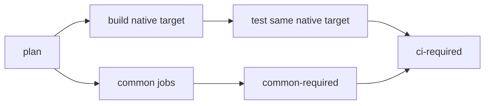

# Continuous integration

Use the `ci-required` check to decide if a commit passes CI. Open the
[test workflow](../.github/workflows/test.yml) to find the failed job. The
job name identifies common validation, a native build, or a native test.
Use [Testing](testing.md) to run an individual suite locally.

CI has three levels:

| Event | Common jobs | Native targets | Full mode |
| --- | --- | --- | --- |
| Ready pull request that changes only static paths | `common-static` | None | No |
| Other ready pull request | All six | Linux x86-64 | No |
| Push to `main`, weekly scheduled run, manual run, release candidate | All six | All five | Yes |

Static paths cannot change a Rust build, a test binary, a server fixture, or
the validation graph. They are the documentation, root Markdown files,
`scripts/README.md`, the automation tests in `scripts/tests/`, agent
instructions, the release and maintenance workflows and their scripts, and
the [website](../website/README.md) and its workflow.
The [CI policy](../scripts/ci/platforms.py) lists them. One other changed
path selects the complete pull request level. Markdown files of vendored
crates are not static paths, because a crate can embed its README.

A pull request gets fast feedback from the common jobs and one native target.
It does not wait for macOS builds. After the merge, the `main` run tests all
four native targets. If a target fails on `main`, fix the change or revert it.
A release candidate always passes all five native targets before publication,
because the release workflow runs its own full validation. Full mode adds
timing stress and measurements; see [Full runs and releases](#full-runs-and-releases).

The workflow also accepts merge queue runs (`merge_group`). Such a run tests
all five native targets before the merge, without full mode. GitHub offers a
merge queue only to repositories that an organization owns. This repository
belongs to a personal account, so it does not use a merge queue.

The native targets and their runners are:

| Target | Build runner | Test runner |
| --- | --- | --- |
| macOS ARM64 | `macos-15` | `macos-15` |
| macOS Intel | `macos-15` | `macos-15-intel` |
| Linux x86-64 | `ubuntu-24.04` | `ubuntu-24.04` |
| Linux ARM64 | `ubuntu-24.04-arm` | `ubuntu-24.04-arm` |

Intel runners compile several times slower than Apple silicon runners. Thus
the macOS ARM64 runner compiles the Intel candidate and test binaries for
`x86_64-apple-darwin`. The tests and the package checks run on an Intel runner.

A draft pull request starts no validation. Mark it ready to start the checks.
A run for a draft skips every job, and GitHub counts its skipped `ci-required`
check as passed. Thus a draft run uses its own concurrency group: it cannot
cancel the run that starts when the pull request becomes ready.
Fork pull requests use disposable servers and synthetic credentials. They do
not receive repository secrets. `main` and release runs never skip a job
because of the changed paths.

## Job order

The [test workflow](../.github/workflows/test.yml) contains the shared graph.
It runs directly for pull requests and `main`, so check names have no wrapper
prefix. The release workflow calls this same graph. Each job checks out one
immutable commit. A pull request uses its merge commit.

There is one build/test pair for each supported native target. The `plan`
job selects the level and the native targets. Jobs of other targets are
skipped. Native builds start with common validation, so compilation overlaps
the common tests. A native test starts when its own build is complete. It does
not wait for common validation or for the other native builds. A common
failure can thus leave native tests running, but `ci-required` fails.

## Common jobs

Common jobs run on Linux x86-64. They prove portable behavior once before
native tests start. The [CI policy](../scripts/ci/platforms.py) owns their
suite selections.

| Job | Work |
| --- | --- |
| `plan` | Select the common jobs for the requested source commit. |
| `common-static` | Check Python and shell scripts, workflow syntax, harness tests, action pins, dependency policy and sources, advisories, licenses, unused dependencies, and Rust formatting. |
| `common-core` | Run core Clippy, API documentation checks, and portable unit and integration tests with line coverage. The 80% floor remains enforced. UI features are off. |
| `common-backend` | Prepare one core integration executable. Use Docker to test Kyuubi, Postgres, and Trino connectors and workers, including authentication, TLS, cancellation, and transport scenarios. No GPUI build is required. |
| `common-headless-ui` | Run application Clippy, application unit tests, doctests, and portable headless UI tests. These need no server. In full mode, repeat the UI timing regressions with the same binaries. |
| `common-server-ui` | Run the headless UI scenarios with all three server types: the e2e suite against Kyuubi, and the Postgres and Trino window scenarios. |
| `common-performance` | Build the SQL, dbt, and export benchmarks in one Cargo request and enforce their existing budgets. |
| `common-required` | Require every common job to succeed. Verify the exact suite set, commit, target, and nonempty nextest reports. Missing, cancelled, duplicate, stale, or failed results stop native tests. |

The two UI jobs run in parallel. They prepare their own test binaries with
the same compiler variant, so `common-server-ui` restores the Rust cache of
`common-headless-ui` and does not save one.

Core coverage uses instrumented binaries. Backend tests use normal core
binaries. UI tests use the explicit UI test feature on Linux. Performance
probes use an optimized profile. These are different compiler variants;
they cannot safely share the same executable. Clippy emits compiler metadata,
not runnable test binaries.

Portable core tests do not run again in the application unit selection.
The local `postgres` and `trino` suites each combine a core and a headless UI
layer. CI selects those layers separately. Their fixture setup and scenario
filters stay the same.

## Native jobs

Each `build-TARGET` job prepares its OS test binaries and builds one production
release package. On macOS it also prepares the native font probe, window
observer, and desktop driver. The font probe uses the debug test-support
dependencies that the native UI tests use. It does not cause a second release
build of GPUI.

Production application Clippy runs in `build-macos-arm64` and
`build-linux-x86_64`, one architecture for each OS. The other architectures
have the same OS code, so another complete check build adds little lint
coverage. macOS Clippy also checks all test targets to retain lint coverage of
OS-specific test code.

Each `test-TARGET` job downloads its prepared binaries and candidate package.
It verifies the source snapshot, compiler settings, Rust toolchain, native
target, and file digests before it runs tests. There is no Cargo build cache
or fallback compilation in these jobs.

All targets inspect and launch the extracted production package. Linux uses
X11, Xvfb, and software Vulkan. Both Linux architectures test a private D-Bus
session and synthetic secret store. Both macOS architectures test synthetic
Keychain items and an isolated Keychain, native font/layout behavior, and the
OS branches of shortcut assertions. The macOS desktop suite tests the exact
candidate archive with native input, menus, window closure, credentials,
persistence, and pixel checks.

The few macOS headless assertions remain because they contain OS-dependent
expectations. They do not repeat the complete portable UI or backend suites.
The package uses production features. Test support is confined to test builds.

The final `ci-required` job requires common validation and the tests of the
selected targets to pass. Only a pull request can select fewer than all
common jobs and native targets. The jobs of the other targets must be skipped. It
verifies a result and package receipt for each selected target, and rejects
evidence from other targets. The receipt
digest must match the candidate digest in the build manifest.

## Prepared builds and results

`./qtest prepare` groups the test binaries by compiler flags and profile. It
unites the required Cargo targets and creates one nextest archive per variant.
Archives contain nextest metadata, executables, and runtime build outputs.
`./qtest execute --reuse-builds` verifies and extracts each required archive
once, then runs nextest with its Cargo and binary metadata. Test filters,
ignored-test rules, runtime settings, time limits, and JUnit results still
apply. Missing or changed builds fail instead of compiling again.

The build identity includes the source commit and file snapshot, native target,
compiler environment, Cargo configuration, and Rust toolchain. The toolchain
identity is the Rust release and commit, without the build host. The manifest
records the compiled target triple separately, and execution rejects a
different triple. A build manifest records archive and native asset digests. Each test result records
the manifest digest. Logs and per-attempt reports remain separate.

Common evidence, native evidence, and candidates remain available for 14 days.
Prepared transfer artifacts remain for two days. They are artifacts of the
current workflow run, not caches. Rust caches only speed up compilation.
Each cache has one saving job. Only pushes to `main` save caches. Other runs
restore them. `common-static` compiles nothing
and has no cache. A separate
[maintenance workflow](../.github/workflows/maintenance.yml) runs after a
`main` push run completes, including failed runs. Its `cache-cleanup` job removes replaced caches
and the caches of shared keys that the workflow no longer uses. The repository
cache limit is 10 GB. When the caches use more, GitHub removes the least
recently used caches, and builds compile from the start.
Validation keeps read-only permissions. Cleanup uses trusted default-branch
code and has permission to delete caches.

## Full runs and releases

Pushes to `main`, the weekly scheduled run, manual runs, and release candidates use full
mode. Pull requests run the same functional tests on Linux x86-64, without
full mode. Full mode also repeats the
three portable UI timing regressions 100 times with the prepared UI binaries.
A failed repetition fails common validation; no assertion retry hides it.

Full mode records backend transfer measurements on the common Linux host.
It records UI, server-window, and package measurements on macOS ARM64, the
measurement baseline host. These probes are report-only. They do not change
the native functional contract for Intel or Linux. Measurements from `main`
remain for 90 days in `performance-common-*` and `performance-macos-arm64`.

Release candidates restore the Rust caches of `main`, like other runs, but do
not save caches. The scheduled run starts on Sundays at 02:17 UTC and skips
cache restoration. It proves weekly that a clean checkout builds, and it
finds new dependency advisories and changed server images. A push to `main`
cannot replace it in the queue. A manual test run can select `cold-cache`. The release workflow downloads qualified
candidates. It wraps the macOS app in a DMG, mounts and launches that app, and
forwards the Linux archives. It does not compile the application again.
See [Development](development.md#hooks-and-continuous-integration) for release
publication and channel details.

## Merge and administration

The `main` ruleset requires only the `ci-required` check. A pull request
merges when its own level passes, so it can merge with a defect that only
macOS or Linux ARM64 shows. Check the `main` run after each merge. Fix or
revert a failed native target before the next release.

After a change to this graph, check the first `main` run. It must contain the six common jobs
and all five native build/test pairs, including Intel macOS. Check a full run
for the timing stress evidence. A release still needs a successful manual
release run before its new publication path has live release evidence.

## Known gaps

Linux native package checks do not qualify
Wayland or hardware GPU behavior. The headless UI suite does not prove native
rendering. Linux has native window and credential checks, but no native input,
clipboard, or persistence driver yet. Common GPUI tests cover those portable
behaviors. macOS desktop tests require an unlocked desktop and automation
permissions. Local tests cannot verify GitHub runner allocation, artifact
transfer, cancellation events, ruleset settings, or actual release publication.

## Windows validation

`windows-x86_64` uses `windows-latest` and `x86_64-pc-windows-msvc`.
The build job prepares core tests and the native release candidate. The test
job consumes those artifacts, runs core tests and synthetic Credential Manager
tests, then checks the archive and waits for the demo window. The qualification
receipt binds the source commit to the archive digest. Release publication
checks the receipt before it publishes `Qrow-VERSION-windows-x86_64.zip` and
includes the zip in `SHA256SUMS`.

Pull requests keep the Linux fast path. Full workflow runs also validate
Windows. Windows does not run Docker server fixtures or headless UI tests.
Windows ARM64, an installer, signing, and embedded icon/version resources are
not supplied. Real Windows desktop interaction still needs manual checks.
