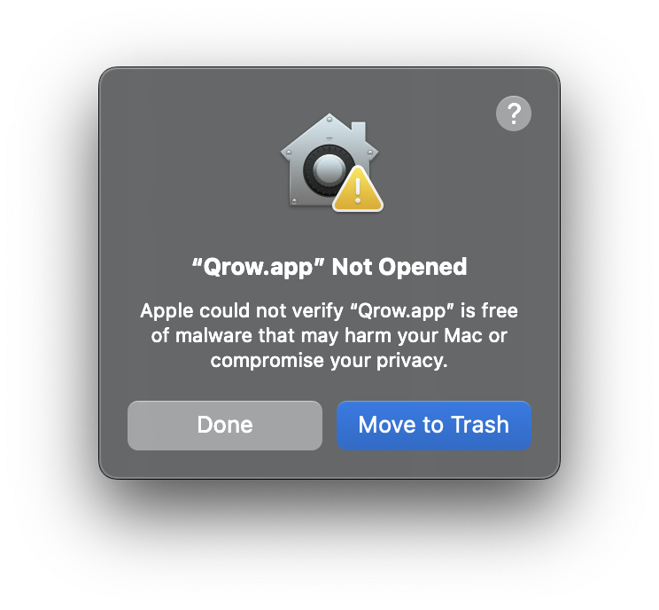
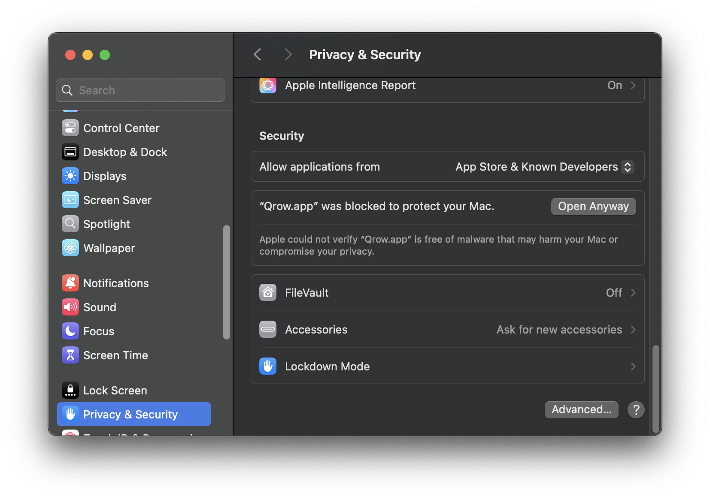

# Installation

Install Qrow from a package manager or from the packages on
[GitHub Releases](https://github.com/vsevolodbazhan/qrow/releases). Replace
`VERSION` in the file names below with the release version.

| System | Requirements | Package |
| --- | --- | --- |
| macOS | macOS 12 or later, a Metal-capable GPU | `Qrow-VERSION-arm64.dmg` (Apple Silicon) or `Qrow-VERSION-x86_64.dmg` (Intel) |
| Windows | Windows 10 or later | `Qrow-VERSION-windows-x86_64-setup.exe` (Intel/AMD) or `Qrow-VERSION-windows-aarch64-setup.exe` (ARM64), or the portable `Qrow-VERSION-windows-ARCH.zip` |
| Linux | Wayland or X11 desktop, Vulkan, a Secret Service provider | `Qrow-VERSION-linux-x86_64.tar.gz` or `Qrow-VERSION-linux-aarch64.tar.gz` |

The packages do not have macOS or Windows code signatures. These signatures
need paid developer certificates. Thus macOS and Windows show a warning the
first time you open Qrow. The sections below show how to continue. To make
sure that a package comes from the Qrow release process, see
[Verify a download](#verify-a-download).

## macOS

Install Qrow from the [Homebrew tap](https://github.com/vsevolodbazhan/homebrew-qrow):

```sh
brew tap vsevolodbazhan/qrow
brew install --cask vsevolodbazhan/qrow/qrow
```

To install the latest nightly build, use the separate cask:

```sh
brew install --cask vsevolodbazhan/qrow/qrow@nightly
```

The Homebrew casks install the Apple Silicon build only. On an Intel Mac,
download the `x86_64` DMG from GitHub Releases.

Alternatively, download the DMG for your Mac, open it, and drag Qrow to
Applications.

### Gatekeeper warning



macOS shows this warning because Qrow is not notarized. To open Qrow:

1. Open Qrow. You see the warning. Close it.
2. Open **System Settings → Privacy & Security** and click **Open Anyway**.



## Windows

Install Qrow from the [Scoop bucket](https://github.com/vsevolodbazhan/scoop-qrow):

```powershell
scoop bucket add qrow https://github.com/vsevolodbazhan/scoop-qrow
scoop install qrow
```

To install the latest nightly build, use `scoop install qrow-nightly`. To
upgrade, use `scoop update qrow` or `scoop update qrow-nightly`. Both packages
add Qrow to the Start menu and use the same workspace and settings.

Alternatively, download the installer for your processor and run it. The
installer installs Qrow for your user account and adds it to the Start menu.
It does not need administrator rights. To install for all users, select that
option in the first dialog.

- **Upgrade:** run the installer of the new version. It closes a running Qrow
  first.
- **Remove:** open **Settings → Apps → Installed apps**, find Qrow, and select
  **Uninstall**. Your workspace and settings stay on the computer.

To use Qrow without an installer, extract the portable
`Qrow-VERSION-windows-ARCH.zip` to a folder and run `qrow.exe`.

Windows support is new. It has had less real-desktop use than macOS and Linux.
Please report problems in [issues](https://github.com/vsevolodbazhan/qrow/issues).

### SmartScreen warning

The installer is not signed, so your browser can warn about the download, and
Windows can show **Windows protected your PC** when you run it. To continue:

1. In the browser download list, select **Keep** if the browser asks.
2. Run the installer. In the SmartScreen dialog, select **More info**.
3. Make sure that the file name is a Qrow installer, then select **Run anyway**.

## Linux

Download the archive for your architecture. Extract it into `~/.local` and make
sure that `~/.local/bin` is in your `PATH`:

```sh
mkdir -p ~/.local
tar -xzf Qrow-VERSION-linux-ARCH.tar.gz -C ~/.local
```

The archive includes a desktop launcher. Saved passwords need a desktop Secret
Service, such as GNOME Keyring. The archive uses the system libraries and is
built on Ubuntu 24.04. Use it on that or a newer, compatible distribution.

Use the application menu at the top left for Settings and other commands.

## Updates

Release builds check for a new version of their channel. A stable build
looks for stable releases, and a nightly build looks for nightly releases.
The first check starts a few seconds after launch. While Qrow is open, it
checks again when the last check is more than a day old. To stop the automatic checks, turn off
**Settings → Updates → Check Automatically**. To check at any time, open
**About Qrow** and select **Check for updates**.

What happens next depends on how you installed Qrow:

| Installation | Update |
| --- | --- |
| Linux archive in a folder that you can write, such as `~/.local` | Qrow downloads the new version in the background and shows **Restart to update**. |
| Homebrew or Scoop | Qrow shows the command that updates it, for example `brew upgrade --cask qrow`. |
| Flatpak or Snap | Qrow tells you to update it with that tool. |
| macOS DMG, Windows installer, or Windows portable archive | Qrow shows the new version and a link to the release. Install it as in the sections above. |
| Linux archive in a system folder, such as `/usr` | Qrow shows the new version and a link to the release. |

Before Qrow installs an update, it verifies the signed checksums of the
release, as in [Verify a download](#verify-a-download), and the checksum of
the package. If a check fails, Qrow keeps the installed version. After
**Restart to update**, Qrow asks before it stops running work, saves the
workspace, and starts the new version.

The check sends requests to `api.github.com` and `github.com`. A download
also goes to the GitHub server that stores release files. The requests
contain the Qrow version and no workspace data. Development builds do not
check for updates.

## Verify a download

Each release has a `SHA256SUMS` file with the checksums of all packages, and a
`SHA256SUMS.minisig` signature of that file. The release process signs it with
the Qrow release key. The public key is in
[assets/release/minisign.pub](../assets/release/minisign.pub):

```text
RWR2pcgdcxt7jUi0QyCxd/bGK6kkC1Ggku3NNiniI/1PqQDEBbBkbzlG
```

Download `SHA256SUMS`, `SHA256SUMS.minisig`, and your package into one folder.
Then use [minisign](https://jedisct1.github.io/minisign/) to verify the
signature, and verify the checksum of your package:

```sh
minisign -Vm SHA256SUMS -P RWR2pcgdcxt7jUi0QyCxd/bGK6kkC1Ggku3NNiniI/1PqQDEBbBkbzlG
sha256sum --check --ignore-missing SHA256SUMS
```

On macOS, use `shasum -a 256 --check --ignore-missing SHA256SUMS` for the
second command. The first command shows the trusted comment
`Qrow release TAG`. Make sure that `TAG` is the release that you downloaded.
Releases before the first signed release do not have a signature.
